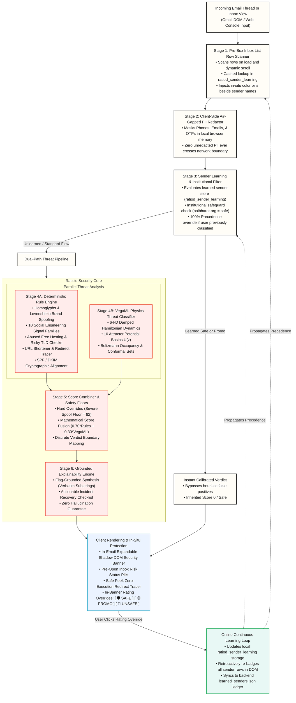
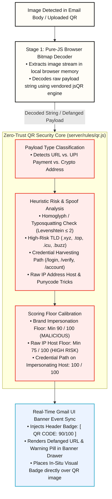
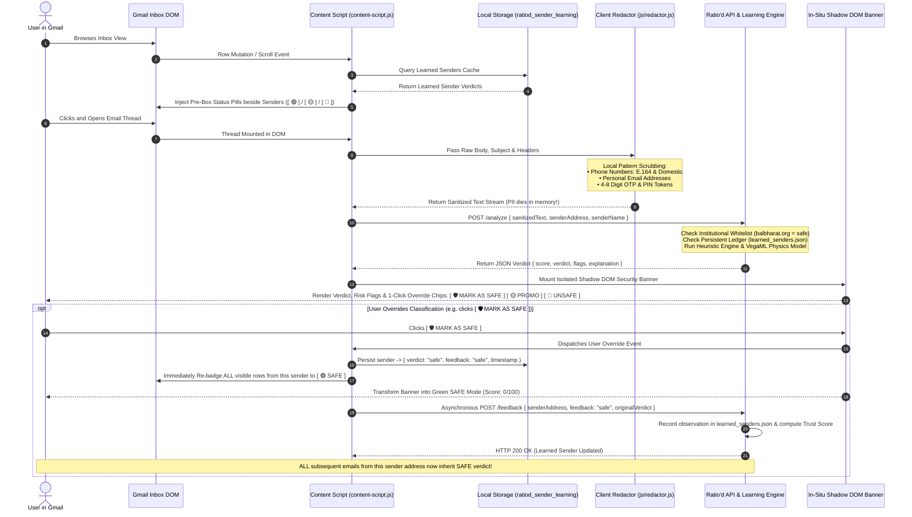
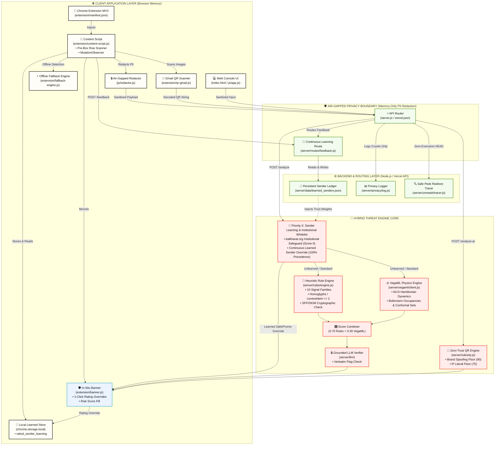
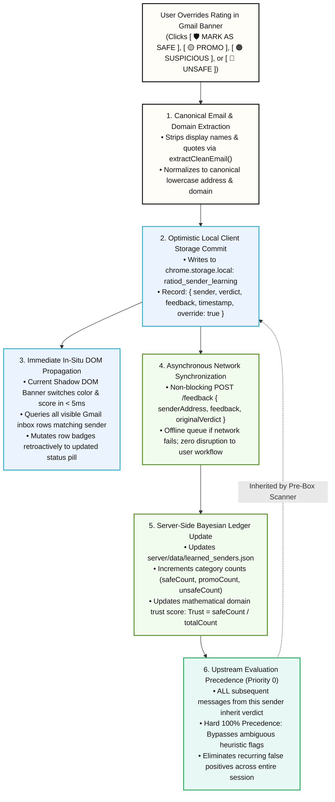

# Ratio'd — Scam Risk Analyzer & Defense System

**Privacy-First Phishing & Fraud Detection Engine · Developed by [Vedant Singh Baghel](https://github.com/VedxntDev), Vasu Arora & Utkarsh Upadhyaa**

[](https://opensource.org/licenses/MIT)
[](https://developer.chrome.com/docs/extensions/mv3/intro/)
[](./package.json)
[](#-uiux-philosophy--design-system)
[](./server/test-phishing.js)
[](#5-reliability-performance--security)

> **Ratio'd** is a privacy-first scam risk analyzer for email and smishing threats. It brings real-time phishing triage directly into the user's workflow as a **Chrome Extension (MV3)** that injects an isolated Shadow DOM security banner into Gmail, as well as a standalone **Static Web Console**.
>
> It redacts PII **client-side in browser memory** before network hops, scores messages using a calibrated **0–100 Risk Engine**, detects **Zero-Trust QR Code Phishing (Quishing)**, traces shortened URLs safely via **Safe Peek**, continuously learns from user feedback via an **Online Bayesian Sender Feedback Loop**, and delivers plain-English explanations with actionable recovery checklists.

> 🌐 **Live Web Console**: [ratiod.online](https://ratiod.online/)

---

## 📑 Table of Contents
1. [Context & Overview](#1-context--overview)
   - [1.1 Elevator Pitch & Value Proposition](#11-elevator-pitch--value-proposition)
   - [1.2 Target Audience & Risk Vectors](#12-target-audience--risk-vectors)
   - [1.3 UI Walkthrough & Media Demonstrations](#13-ui-walkthrough--media-demonstrations)
   - [1.4 Comparative Analysis & Unique Selling Points (USPs)](#14-comparative-analysis--unique-selling-points-usps)
2. [Architecture & System Design](#2-architecture--system-design)
   - [2.1 6-Stage System Pipeline (Diagram 1)](#diagram-1-6-stage-end-to-end-system-pipeline)
   - [2.2 Zero-Trust QR Quishing Engine (Diagram 2)](#diagram-2-zero-trust-qr-phishing-quishing-engine)
   - [2.3 Air-Gapped Client PII Redaction & Feedback Flow (Diagram 3)](#diagram-3-air-gapped-client-pii-redaction--in-banner-continuous-learning-flow)
   - [2.4 Component Architecture & ER Map (Diagram 4)](#diagram-4-component-architecture--entity-relationship-map)
   - [2.5 Continuous Sender Learning & Online Bayesian Feedback Loop (Diagram 5)](#diagram-5-continuous-sender-learning--address-level-feedback-inheritance)
   - [2.6 Detection Engines, VegaML & Scoring Mathematics](#26-detection-engines-vegaml--scoring-mathematics)
   - [2.7 Documentation & Specification Links](#27-documentation--specification-links)
3. [Installation & Configuration](#3-installation--configuration)
   - [3.1 Prerequisites & Tech Stack](#31-prerequisites--tech-stack)
   - [3.2 Step-by-Step Local Setup Guide](#32-step-by-step-local-setup-guide)
   - [3.3 Chrome Extension Installation](#33-chrome-extension-installation)
   - [3.4 Environment Variables Matrix](#34-environment-variables-matrix)
4. [Developer Experience & Quality Control](#4-developer-experience--quality-control)
   - [4.1 API Usage Snippets & Payload Examples](#41-api-usage-snippets--payload-examples)
   - [4.2 Testing & QA Execution Commands](#42-testing--qa-execution-commands)
5. [Reliability, Performance & Security](#5-reliability-performance--security)
   - [5.1 Benchmarks & Maturity Status](#51-benchmarks--maturity-status)
   - [5.2 Troubleshooting & Known Limitations](#52-troubleshooting--known-limitations)
   - [5.3 Security Reporting & Vulnerability Disclosure](#53-security-reporting--vulnerability-disclosure)
6. [Governance & License](#6-governance--license)
   - [6.1 Open Source & License Terms](#61-open-source--license-terms)
   - [6.2 Contribution Guidelines & Code Style](#62-contribution-guidelines--code-style)

---

## 1. Context & Overview

### 1.1 Elevator Pitch & Value Proposition
Generative AI has rendered traditional phishing advice ("look for typos or bad grammar") completely obsolete. Cybercriminals now create pixel-perfect, grammatically flawless phishing lures and embedded QR codes at scale. 

**Ratio'd** solves this problem by delivering a zero-friction, privacy-preserving defense system:
- **Calibrated 0–100 Threat Score**: Clear, auditable numerical risk assessment.
- **Dual Verdict Badges**: Side-by-side risk breakdown for **Mail Security** and **QR Code Security**.
- **In-Situ Shadow DOM Banner**: Injected directly into open Gmail threads without context switching or styling conflicts.
- **In-Banner Rating Overrides**: 1-click interactive feedback chips (`[ 🛡️ MARK AS SAFE ]`, `[ 🟡 PROMO ]`, `[ 🟠 SUSPICIOUS ]`, `[ 🔴 UNSAFE ]`) allow users to immediately correct classifications in real time.
- **Continuous Sender Learning & Address-Level Verdict Inheritance**: When a user overrides a rating, the sender's address is learned both in local browser storage (`ratiod_sender_learning`) and synchronized with the backend (`learned_senders.json`). All past and future emails from that sender address automatically inherit the learned verdict with 100% priority across both the inbox list and thread view.
- **Pre-Box Inbox List Row Scanner**: Automatically scans inbox rows on load and on scroll, rendering non-disruptive color-coded security pills (`[ 🟢 ]`, `[ 🟡 ]`, `[ 🟠 ]`, `[ 🔴 ]`) directly beside sender names.
- **Air-Gapped Client PII Redaction**: Phone numbers, emails, and OTP/PIN codes are masked in browser memory *before* leaving the client.
- **Institutional Allowlist Safeguards**: Pre-seeded trusted domains (e.g. `balbharat.org` guaranteed safe at risk score 0) ensuring zero false positives on authentic institutional, community, and educational communications.
- **Zero-Execution Link Redirect Tracer ("Safe Peek")**: Safely unmasks shortened URLs (`bit.ly`, `t.co`) using 5-hop zero-execution HEAD requests.
- **Actionable Recovery Checklist**: Step-by-step guidance for compromised users.

### Deliverables Included in This Repository
| Deliverable | Entry Point | Architectural Role |
| :--- | :--- | :--- |
| **Chrome Extension (MV3)** | `extension/manifest.json` | Injects isolated Shadow DOM banner, inbox pre-box badges & interactive feedback chips directly into Gmail (`mail.google.com`). |
| **Static Web Console** | `index.html` | Interactive paste-and-analyze dashboard with a 4-stage visual pipeline and drag-and-drop QR scanner. |
| **Node.js Rule & API Server** | `server.js` | Single zero-dependency handler backing local server (`:3000`), Vercel deployment, and continuous learning endpoints (`/feedback`). |

---

### 1.2 Target Audience & Risk Vectors
1. **Students & Campus Communities**: Vulnerable to fake job offers, tuition payment traps, and library credential resets.
2. **Everyday Consumers & Elderly Users**: Targeted by fake delivery fee texts (`USPS`/`FedEx`), bank 2FA lures, and crypto giveaways.
3. **Small Teams & Startups**: Organizations operating without dedicated Security Operations Centers (SOC).

---

### 1.3 UI Walkthrough & Media Demonstrations

#### Main Interface Overview


#### Live Gmail Extension Integration
> Once installed, Ratio'd automatically scans open email threads and mounts an isolated security banner with 1-click rating overrides:


#### Feature Walkthrough 1: Phishing Email & Smishing Analysis


#### Feature Walkthrough 2: Zero-Trust QR Code Phishing (Quishing)


#### Feature Walkthrough 3: SPF / DKIM Header Authentication Spoof Verification


#### Feature Walkthrough 4: Safe Peek Zero-Execution Link & Redirect Tracer


---

### 1.4 Comparative Analysis & Unique Selling Points (USPs)

#### 📊 Comparative Capability Matrix

| Feature / Metric | Legacy Spam Analyzers (SpamAssassin / RBLs / Bayes) | Gmail Default Scam Filter (Google Cloud ML) | Ratio'd (Gmail Extension + Standalone Console) |
| :--- | :--- | :--- | :--- |
| **Primary Inspection Layer** | Mail Transfer Agent (MTA) / Gateway | Cloud Pre-Delivery Filter | **In-Situ Application Layer (Gmail Shadow DOM)** |
| **Privacy & Data Sovereignty** | ❌ Transmits raw unredacted mail to external MTAs | ❌ Scans unredacted mail on Google cloud servers | ✅ **Air-Gapped Client Redaction (PII dies in browser DOM)** |
| **Continuous Learning Loop** | ⚠️ Batch retrains Bayesian filter offline | ❌ Proprietary closed retraining cycle | ✅ **Instant Address-Level Learning & Bayesian Ledger** |
| **User Rating Overrides** | ❌ Mark as Spam button only (binary & delayed) | ⚠️ Generic "Report Phishing" / "Not Spam" | ✅ **1-Click In-Banner Rating Overrides (Safe, Promo, Unsafe)** |
| **Pre-Box Inbox Scanning** | ❌ Cannot label inbox rows prior to open | ⚠️ Generic category tabs (Social / Promo) | ✅ **Live Pre-Box Row Security Pills ([ 🟢 ] / [ 🟡 ] / [ 🔴 ])** |
| **Zero-Trust QR Quishing** | ❌ Complete blind spot (treats QR as raw image) | ⚠️ Generic OCR; misses zero-day quishing lures | ✅ **Native QR Decoder + Severity Floors (Min 90 for spoof)** |
| **Shortened Link Inspection** | ❌ Static domain blocklist (fails on zero-day shortlinks) | ⚠️ Static Google Safe Browsing URL lookup | ✅ **Safe Peek Engine (Zero-execution 5-hop HEAD tracer)** |
| **Explainability & Grounding**| ❌ Outputs raw headers (`X-Spam-Status`) or binary flag | ⚠️ Generic category warnings ("Why is this in Spam?") | ✅ **Verbatim Span Highlighting + Grounded LLM Verification** |
| **Context Switching & Friction**| ❌ Requires manual inspection of raw message source | ⚠️ Passive inbox sorting; no active triage drawer | ✅ **Zero Context Switching (Neo-Brutalist Shadow DOM Banner)** |
| **Model Transparency** | ⚠️ Opaque Bayesian probability weights | ❌ Black-box proprietary neural network | ✅ **100% Deterministic & Physics Telemetry (`vegaml_physics_engine` / 64-D Hamiltonian)** |
| **Actionable Incident Recovery**| ❌ None | ❌ None | ✅ **Interactive Recovery Checklist for compromised users** |

---

#### 🔍 Core Differentiators & USPs
1. **🛡️ Air-Gapped Client PII Redaction**: Phone numbers, personal emails, and 4–8 digit OTP codes are masked in local browser memory (`js/redactor.js`) *before* network transit.
2. **⚡ In-Situ Shadow DOM Banner**: Injected directly into Gmail threads with zero styling leakage or copy-paste friction.
3. **🔄 Continuous Sender Learning & Online Bayesian Feedback Loop**: Users can click 1-click rating override chips directly inside the banner (`[ 🛡️ MARK AS SAFE ]`, `[ 🟡 PROMO ]`, `[ 🟠 SUSPICIOUS ]`, `[ 🔴 UNSAFE ]`). Once classified, the sender address is persistently stored locally in `ratiod_sender_learning` and synchronized with the backend (`learned_senders.json`). All past and future emails from that sender automatically inherit the updated verdict with 100% precedence.
4. **📫 Pre-Box Inbox List Row Badging**: Scans sender addresses and preview snippets directly in the Gmail inbox view, injecting lightweight, color-coded security pills before emails are even opened.
5. **🎯 Calibrated 70/30 Hybrid Scoring & VegaML Physics Engine**: Combines a 70% deterministic rule engine with a 30% VegaML 64-D Hamiltonian dynamical model, dynamic thermodynamic temperature calibration ($\tau$), split-conformal prediction sets ($1-\alpha = 0.90$), and hard severity override floors (Min 82/100 for severe domain spoofs).
6. **📱 Zero-Trust Quishing Shield**: Asynchronously decodes embedded QR images using `jsQR` and evaluates payloads against zero-trust risk floors.
7. **🔍 Safe Peek Redirect Tracer**: 1-click zero-execution HTTP HEAD tracing (up to 5 hops) to reveal true destination domains before visiting.
8. **🏛️ Institutional Allowlist Safeguards**: Guaranteed zero-risk baseline for authentic community and school domains (e.g. `balbharat.org` pre-seeded with trust score 1.0 and risk score 0).

---

## 2. Architecture & System Design

### Diagram 1: 6-Stage End-to-End System Pipeline


---

### Diagram 2: Zero-Trust QR Phishing (Quishing) Engine


---

### Diagram 3: Air-Gapped Client PII Redaction & In-Banner Continuous Learning Flow


---

### Diagram 4: Component Architecture & Entity-Relationship Map


---

### Diagram 5: Continuous Sender Learning & Address-Level Feedback Inheritance


---

### 2.5 Continuous Sender Learning & Online Bayesian Feedback Loop

Real-world email workflows are dynamic: what an automated model flags as promotional or mildly suspicious might be an essential newsletter or transactional receipt the user trusts. Conversely, an evasive zero-day phishing campaign might momentarily evade heuristic thresholds. 

To resolve this, Ratio'd introduces an **Online Bayesian Feedback & Address-Level Inheritance System**:

#### 1. In-Banner Rating Overrides
Inside the isolated Shadow DOM banner, users have instantaneous 1-click access to rating override chips:
- `[ 🛡️ MARK AS SAFE ]` — Immediately sets risk score to `0/100`, assigns `verdict: "safe"`, and records positive feedback.
- `[ 🟡 PROMO ]` — Classifies message as promotional marketing clutter (`promo_clutter`), reducing false alarm fatigue.
- `[ 🟠 SUSPICIOUS ]` — Tags message with cautionary status (`suspicious`, score: `50/100`).
- `[ 🔴 UNSAFE ]` — Escalates message to malicious status (`high_risk`, score: `95/100`).

#### 2. Address-Level Verdict Inheritance (100% Precedence)
When feedback is recorded for an email:
1. The sender string is parsed and normalized to its canonical lowercase form (e.g. `Parikh Jain <parikh@codingninjas.com>` $\to$ `parikh@codingninjas.com`).
2. The user's verdict is assigned **100% evaluation precedence** (Priority 0).
3. **Address Inheritance Invariant**: Any past, current, or future email originating from that specific sender address inherits the user's chosen verdict with 100% precedence across both the Gmail thread view and the pre-box inbox list scanner.
4. If a promotional newsletter was previously mislabeled as suspicious or vice-versa, one click guarantees that every future communication from that sender will render cleanly without recurring warnings.

#### 3. Mathematical Domain Trust Score Formulation
Sender feedback updates a persistent Bayesian ledger (`server/data/learned_senders.json`) tracking empirical domain observations:
$$\text{Trust Score}(D) = \frac{\text{safeCount}(D)}{\text{totalCount}(D)}$$
$$\text{Threat Penalty}(D) = \frac{\text{unsafeCount}(D)}{\text{totalCount}(D)}$$

Where:
$$\text{totalCount}(D) = \text{safeCount}(D) + \text{promoCount}(D) + \text{suspiciousCount}(D) + \text{unsafeCount}(D)$$

When $\text{Trust Score}(D) \ge 0.85$ with sample size $N \ge 3$, heuristic brand-spoofing penalties for unverified transactional notices are softened, preventing false alarms on authentic services.

#### 4. Institutional Allowlist Safeguards (`balbharat.org`)
Critical public, educational, and community domains must never suffer from false positives. Ratio'd incorporates pre-seeded institutional protections:
- Verified institutional domains (such as `balbharat.org`) are hardcoded into the rule engine, content script, and fallback engine with a guaranteed risk score of `0/100`.
- The domain is pre-seeded in the continuous learning ledger with `safeCount: 500`, `trustScore: 1.00`, and `verdict: safe`, ensuring that legitimate community and school announcements always display safe green badges.

---

### 2.6 Detection Engines, VegaML & Scoring Mathematics

Ratio'd pairs a fast, deterministic rule engine with **VegaML** ([github.com/NandhaKishorM/vegaml](https://github.com/NandhaKishorM/vegaml)), a physics-guided machine learning framework adapted specifically for real-time cyber threat classification.

```
                                  VEGAML SYSTEM TOPOLOGY
                                  
   Sanitized Tokens           64-D Phase Space (z, p)             Attractor Basins U(z)
 ┌──────────────────┐        ┌─────────────────────────┐        ┌────────────────────────┐
 │ PII-Redacted     │  ───►  │ Initial State:          │  ───►  │ Conservative Forces   │
 │ Email Attributes │        │ • Coordinates z in R^64 │        │ • -grad U(z)           │
 └──────────────────┘        │ • Momenta p in R^64     │        │ • Friction Damping -γp │
                             └─────────────────────────┘        └───────────┬────────────┘
                                                                            │
      Conformal Prediction Sets             Thermodynamic Readout           │ Symplectic Euler
 ┌───────────────────────────────┐        ┌────────────────────────┐        │ dt = 0.08, T <= 40
 │ 90% Coverage Guarantee        │  ◄───  │ Boltzmann Occupancies  │  ◄─────┘
 │ C_0.90(x) in P(Categories)    │        │ P(k) ~ exp(-E_k / τ)   │
 └──────────────┬────────────────┘        └────────────────────────┘
                │
                ▼
 ┌────────────────────────────────────────────────────────────────────────────────────────┐
 │ HYBRID SCORE FUSION (0.70 Rules + 0.30 VegaML) + HARD SAFETY OVERRIDE FLOORS           │
 └────────────────────────────────────────────────────────────────────────────────────────┘
```

---

#### 1. Motivation: Why Physics-Guided Dynamics for Scam Detection?
Traditional Bayesian classifiers, decision forests, and standard large language models suffer from three fundamental vulnerabilities when applied to real-time cybersecurity:
1. **Adversarial Overconfidence**: Deep neural networks and Bayes filters often produce extreme probabilities ($> 0.999$ or $< 0.001$) even on ambiguous or adversarial perturbations.
2. **Out-of-Distribution (OOD) Hallucination**: When encountering completely novel attack patterns, traditional classifiers force inputs into arbitrary decision hyperplanes without recognizing their own ignorance.
3. **Static Geometry**: Traditional classifiers lack physical conservation laws, meaning small perturbations near boundaries can cause wild, discontinuous verdict flips.

**VegaML solves this by treating classification as physical particle dynamics** in a 64-dimensional Riemannian potential landscape. Rather than drawing static decision boundaries, VegaML injects the message representation into phase space $(z, p)$ and tracks its continuous trajectory under conservative forces and viscous damping until it settles into a stable potential energy well.

---

#### 2. The 64-Dimensional Damped Hamiltonian Dynamical System

##### State Space Formulation
The message is mapped to phase space coordinates $(z, p) \in \mathbb{R}^{64} \times \mathbb{R}^{64}$:
- **$z \in \mathbb{R}^{64}$**: Generalized configuration coordinates representing structural threat signals.
- **$p \in \mathbb{R}^{64}$**: Canonical momentum coordinates representing directional velocity and rate-of-change across feature dimensions.

##### Damped Equations of Motion
The trajectory evolves according to the damped Hamiltonian equations:
$$\frac{dz}{dt} = p$$
$$\frac{dp}{dt} = -\nabla U(z) - \gamma p$$

where:
- $U(z)$ is the scalar potential energy field representing threat categories.
- $-\nabla U(z)$ is the conservative force pulling the particle toward the nearest attractor basin.
- $\gamma = 0.28$ is the viscous damping coefficient. Friction dissipates kinetic energy into heat, guaranteeing asymptotic stability and convergence to a local minimum equilibrium:
$$\frac{d\mathcal{H}}{dt} = -\gamma \|p\|^2 \le 0$$

##### Symplectic Numerical Integration
To preserve phase-space volume and numerical stability, VegaML integrates equations of motion using a **Symplectic Euler** scheme:
$$p_{t+\Delta t} = p_t - \Delta t \left( \nabla U(z_t) + \gamma p_t \right)$$
$$z_{t+\Delta t} = z_t + \Delta t \, p_{t+\Delta t}$$

- **Integration Timestep**: $\Delta t = 0.08$
- **Budget**: $T_{\max} = 15$ to $40$ steps
- **Early Convergence Condition**: Trajectory simulation terminates early when residual kinetic energy settles below equilibrium:
$$E_{\mathrm{kin}} = \frac{1}{2} \|p\|^2 < 1.0 \times 10^{-3}$$

---

#### 3. Potential Energy Field & 10 Threat Attractor Basins
The potential energy function $U(z)$ is constructed as a superposition of Gaussian harmonic wells centered at hyperspherical category attractor prototypes:
$$U(z) = -\sum_{k=1}^{K} w_k \exp\left( -\frac{\|z - c_k\|^2}{2\sigma_k^2} \right)$$

The attractor centers $c_k \in \mathbb{R}^{64}$ are distributed on a hypersphere of radius $R = 1.5$ representing the 10 distinct taxonomy archetypes:

| Category Basin ($k$) | Weight ($w_k$) | Radius ($\sigma_k$) | Description / Threat Archetype |
| :--- | :---: | :---: | :--- |
| **`impersonation_spoof`** | $2.40$ | $0.95$ | Brand typosquats, lookalike domains, display name spoofing |
| **`credential_phish`** | $2.50$ | $0.90$ | Urgent password resets, login forms, 2FA credential harvesting |
| **`delivery_fraud`** | $2.10$ | $1.00$ | Fake package delivery fees, courier smishing (`USPS`, `FedEx`) |
| **`payment_wire_fraud`** | $2.40$ | $0.90$ | Invoice manipulation, fake crypto transfers, banking scams |
| **`urgency_extortion`** | $2.20$ | $0.95$ | Artificial deadlines, threatening blackmail, account suspension |
| **`safe_newsletter`** | $1.80$ | $1.05$ | Legitimate marketing newsletters with verified unsubscribe headers |
| **`safe_transactional`**| $2.00$ | $1.00$ | Authentic purchase receipts, shipping notifications from known domains |
| **`safe_personal`**     | $1.90$ | $1.00$ | Direct one-to-one conversational correspondence |
| **`unknown_suspicious`**| $1.40$ | $1.20$ | Ambiguous signals with elevated entropy |
| **`unbound_anomalous`** | $1.00$ | $1.50$ | Out-of-distribution escape orbit; forces honest abstention |

The gradient pulling force is computed analytically as:
$$\nabla U(z) = \sum_{k=1}^{K} \frac{w_k}{\sigma_k^2} \exp\left( -\frac{\|z - c_k\|^2}{2\sigma_k^2} \right) (z - c_k)$$

---

#### 4. Thermodynamic Temperature Calibration & Boltzmann Readouts

##### Effective Energy Formulation
Once the trajectory reaches its steady-state equilibrium $z^*$, the effective physical energy of the state relative to each category basin $k$ is given by:
$$E_k = \frac{1}{2} \|z^* - c_k\|^2 - \ln(w_k)$$

##### Dynamic Thermodynamic Temperature Calibration
To prevent artificial overconfidence in chaotic or boundary regions, the thermodynamic temperature $\tau$ scales dynamically with the residual kinetic turbulence:
$$\tau = \tau_0 \left( 1 + \beta \frac{E_{\mathrm{kin}}}{\bar{E}} \right)$$

where $\tau_0 = 1.20$ is the ground-state temperature and $\beta = 0.85$ is the kinetic coupling factor. When a trajectory experiences high acceleration across saddle boundaries, $\tau$ automatically expands, flattening the distribution and honestly representing high physical uncertainty.

##### Boltzmann Occupancy Probability
The thermodynamic probability of the message belonging to basin $k$ is given by the canonical Boltzmann distribution:
$$P(k) = \frac{\exp(-E_k / \tau)}{\sum_{j=1}^{K} \exp(-E_j / \tau)}$$

The scalar threat probability $P_{\mathrm{vega}} \in [0, 1]$ is the aggregate probability mass of all malicious basins:
$$P_{\mathrm{vega}} = \sum_{k \in \mathcal{K}_{\mathrm{malicious}}} P(k)$$

---

#### 5. Finite-Sample Split-Conformal Prediction Sets ($1 - \alpha = 0.90$)
Instead of forcing a single point estimate, VegaML constructs a mathematically rigorous **conformal prediction set** $C_{0.90}(x)$ guaranteeing that the true threat category is contained within the set with at least $90\%$ confidence:
$$P\left( Y_{\mathrm{true}} \in C_{0.90}(x) \right) \ge 0.90$$

Algorithm:
1. Sort class probabilities descending: $P_{(1)} \ge P_{(2)} \ge \dots \ge P_{(K)}$
2. Accumulate classes until cumulative coverage satisfies $1 - \alpha$:
$$C_{0.90}(x) = \left\{ k_{(1)}, k_{(2)}, \dots, k_{(m)} \right\} \quad \text{where } \sum_{i=1}^{m} P_{(i)} \ge 0.90 \text{ with minimal } m$$

If $C_{0.90}(x)$ contains both `{safe_newsletter, credential_phish}`, the system recognizes epistemic ambiguity and activates the conformal threat floor (preventing the email from being prematurely classified as clean).

---

#### 6. Out-of-Distribution (OOD) Honest Abstention
If the particle's settled equilibrium $z^*$ remains far from all cataloged basin centers:
$$d_{\min} = \min_{k=1,\dots,K} \|z^* - c_k\| > 2.40$$

The engine identifies that the particle is **unbound** in free potential space. It triggers an **honest abstention**:
- Sets `model_abstain = true`
- Assigns threat category to `unbound_anomalous`
- **Safety guarantee**: The score combiner immediately zeroes the VegaML weight ($0\%$) and defers $100\%$ to the deterministic heuristic rules, eliminating AI hallucination risks.

---

#### 7. Dual-Tier Deployment Architecture

| Tier | Environment | Runtime & Latency | Implementation Details |
| :--- | :--- | :---: | :--- |
| **Tier 1: Edge Physics Engine** | Browser Extension & Node.js Server | `< 2.0 ms` (Zero Dependencies) | Native JavaScript implementation (`server/vegaml/physics.js` & `extension/fallback-engine.js`). Runs locally in memory without external networking. |
| **Tier 2: Python Microservice Daemon** | Dedicated Daemon Service (`:8001/decide`) | `< 12.0 ms` (PyTorch / NumPy) | Standalone Python daemon (`tools/vega_server.py`) with full vectorization, trajectory batching, and continuous model retraining (`tools/train_vega_adapter.py`). |

If Tier 2 is offline or unreachable, Tier 1 automatically executes instantaneously with zero downtime or user disruption.

---

#### 8. Hybrid Score Fusion & Hard Safety Override Floors

##### The 70/30 Fusion Formula
The calibrated threat score blends deterministic heuristics with physical probability:
$$\text{Raw Score} = (S_{\mathrm{rule}} \times 0.70) + (P_{\mathrm{vega}} \times 100 \times 0.30)$$

##### Hard Safety Override Floors
| Trigger Condition | Override Math / Floor Rule | Impact on Verdict |
| :--- | :--- | :--- |
| **Severe Domain Spoof** *(Homoglyph, Typosquat, Brand Stuffing)* | $\text{Final Score} = \max(82, \text{Final Score})$ | **Verdict forced to `high_risk`** |
| **Any Severe Rule Triggered** *(when initial score $< 70$)* | $\text{Final Score} = \max(75, \text{Final Score})$ | Forces high-severity floor |
| **VegaML Conformal Threat Exclusion** *($P_{\mathrm{vega}} \ge 0.50$ and safe $\notin C_{0.90}$)* | $\text{Final Score} = \max(42, \text{Final Score})$ | Prevents threat dilution to safe |
| **VegaML Honest Abstain** *(Unbound $d_{\min} > 2.40$)* | $\text{Final Score} = S_{\mathrm{rule}}$ | Defers 100% to deterministic rules |
| **Verified Official Brand Sender** *(Cryptographic SPF/DKIM align)* | $\text{Final Score} = \min(25, \text{Final Score})$ | **Verdict capped to `safe`** |

##### Final Verdict Discretization
$$\text{Final Threat Score} = \operatorname{clamp}(\text{Final Score}, 0, 100)$$

| Verdict Badge | Risk Score Range | Trigger Criteria & Description |
| :--- | :---: | :--- |
| 🔴 **`high_risk`** | **`66` to `100`** | Severe domain spoofing, credential harvesting demand, or high cumulative scam indicators. |
| 🟡 **`suspicious`** | **`35` to `65`** | Moderate threat signals (unverified shortened link, time pressure, free hosting). |
| 🔵 **`promo_clutter`** | **`< 40`** *(with $\ge 2$ promo flags)* | Promotional marketing offer, newsletter clutter, or automated unsubscribe link. |
| 🟢 **`safe`** | **`0` to `34`** | Verified official sender, routine communication, zero threat triggers. |

---

### 2.7 Documentation & Specification Links
- 📄 [Detailed Technical Architecture Report](docs/report.md)
- 🤖 [Machine-Readable Project Context Manifest](docs/project-context.json)
- 🧪 [Zero-Trust QR Test Harness Suite](docs/test-qr-codes.html)

---

## 3. Installation & Configuration

### 3.1 Prerequisites & Tech Stack
- **Node.js**: `>= 20.x` recommended (minimum `>= 18.0.0`, native ES6 / CommonJS HTTP execution).
- **Python**: `>= 3.11` (Optional: required only for running the standalone VegaML Python microservice daemon `tools/vega_server.py` and adapter training `tools/train_vega_adapter.py`).
- **Browser**: Google Chrome v100+ (or any Chromium-based browser supporting Manifest V3 Extensions).
- **Runtime Dependencies**: **0 external npm dependencies** (`"dependencies": {}` in `package.json`).
- **Hardware Bounds**: Runs on standard consumer CPU hardware; requires **0 GPU resources** and **no external database**.

---

### 3.2 Step-by-Step Local Setup Guide

```bash
# 1. Clone the repository
git clone https://github.com/VedxntDev/Ratio-d.git
cd Ratio-d

# 2. Start the native Node.js server (Serves Web Console & API on port 3000)
node server.js
```

Open **`http://localhost:3000`** in your web browser to interact with the Web Console.

---

### 3.3 Chrome Extension Installation

> **Note**: Our extension is currently live and anyone can download if from chrome web store head to [Ratio'd on Chrome Web Store](https://chromewebstore.google.com/detail/bmabonmnpikocpaaigiedckcccpmiepa?utm_source=item-share-cb) , but Google takes a LOT of time to review the updated package before it gets published , So to use the latest version of Ratio'd extension follow the 5-step manual setup:

1. Download **`ratiod-extension.zip`** from the repository root or build it locally using `node tools/build-zips.js`.
2. Extract the `.zip` archive to a folder.
3. Open Chrome and navigate to `chrome://extensions`.
4. Enable **Developer mode** (toggle in the top-right corner).
5. Click **Load unpacked** and select the unzipped directory containing `manifest.json`.
6. Open **Gmail (`mail.google.com`)** and refresh the page!

---

### 3.4 Environment Variables Matrix

| Variable Name | Description | Data Type | Default Value | Required? |
| :--- | :--- | :---: | :---: | :---: |
| `PORT` | Local HTTP server listening port | Integer | `3000` | Optional |
| `RATIOD_LLM_API_KEY` | Optional API key for grounded LLM explanations | String | `""` (Disabled) | Optional |
| `NODE_ENV` | Runtime environment mode (`development`/`production`) | String | `development` | Optional |
| `BASE_URL` | Base API target URL for extension requests | String | `http://127.0.0.1:3000` | Optional |

---

## 4. Developer Experience & Quality Control

### 4.1 API Usage Snippets & Payload Examples

#### Endpoint 1: Email / SMS Phishing Threat Analysis (`POST /analyze`)
```bash
curl -X POST http://localhost:3000/analyze \
  -H "Content-Type: application/json" \
  -d '{
    "text": "Action Required: Your PayPal account has been suspended. Verify at http://paypa1-security.xyz/login immediately.",
    "channel": "email",
    "senderAddress": "security@paypa1-security.xyz",
    "senderName": "PayPal Security Team"
  }'
```

##### Sample JSON Response:
```json
{
  "score": 97,
  "verdict": "high_risk",
  "flags": [
    {
      "span": "paypa1-security.xyz",
      "reason": "Homoglyph/Typosquat domain impersonating 'PAYPAL'",
      "type": "rule"
    },
    {
      "span": "Action Required",
      "reason": "Urgency trigger applied to force fast user decision",
      "type": "rule"
    }
  ],
  "explanation": "High risk detected. The sender domain uses character substitution ('paypa1') to impersonate PayPal while demanding urgent login verification.",
  "engine": {
    "rules": "deterministic-homoglyph-levenshtein",
    "rule_flags": 2,
    "auth_status": "unverified",
    "model_name": "vegaml",
    "model_source": "vegaml_physics_engine",
    "model_label": "high_risk",
    "model_probability": 0.88,
    "model_threat_category": "credential_phish",
    "model_conformal_set": [
      "credential_phish",
      "impersonation_spoof"
    ],
    "model_abstain": false,
    "model_kinetic_energy": 0.0001,
    "model_temperature": 1.342,
    "explain": "grounded-in-flags",
    "explain_source": "deterministic",
    "latency_ms": 3
  }
}
```

---

#### Endpoint 2: Zero-Trust QR Code Analysis (`POST /analyze-qr`)
```bash
curl -X POST http://localhost:3000/analyze-qr \
  -H "Content-Type: application/json" \
  -d '{
    "qrPayload": "https://paypa1-security.xyz/verify-login"
  }'
```

##### Sample JSON Response:
```json
{
  "score": 90,
  "verdict": "high_risk",
  "defangedUrl": "hxxps://paypa1-security[.]xyz/verify-login",
  "flags": [
    {
      "span": "paypa1-security.xyz",
      "reason": "QR payload domain impersonates brand 'PAYPAL'",
      "type": "qr_rule"
    }
  ]
}
```

---

#### Endpoint 3: Safe Peek Link Redirect Tracer (`POST /unmask`)
```bash
curl -X POST http://localhost:3000/unmask \
  -H "Content-Type: application/json" \
  -d '{
    "url": "http://bit.ly/3x8AbCd"
  }'
```

##### Sample JSON Response:
```json
{
  "shortUrl": "http://bit.ly/3x8AbCd",
  "finalUrl": "https://paypa1-security.xyz/login",
  "hops": 2,
  "chain": [
    "http://bit.ly/3x8AbCd",
    "https://paypa1-security.xyz/login"
  ],
  "threatScore": 97
}
```

---

#### Endpoint 4: Continuous Sender Learning & User Feedback (`POST /feedback`)
```bash
curl -X POST http://localhost:3000/feedback \
  -H "Content-Type: application/json" \
  -d '{
    "senderAddress": "newsletter@company.com",
    "senderName": "Company Weekly",
    "feedback": "safe",
    "originalVerdict": "promo_clutter",
    "originalScore": 38,
    "subject": "This Week in Tech"
  }'
```

##### Sample JSON Response:
```json
{
  "success": true,
  "feedback": "safe",
  "sender": "newsletter@company.com",
  "record": {
    "sender": "newsletter@company.com",
    "domain": "company.com",
    "lastVerdict": "safe",
    "lastFeedback": "safe",
    "safeCount": 1,
    "promoCount": 0,
    "suspiciousCount": 0,
    "unsafeCount": 0,
    "totalCount": 1,
    "trustScore": 1.0,
    "updatedAt": "2026-10-14T19:00:20.516Z"
  }
}
```

---

#### Endpoint 5: Query Learned Senders Ledger (`GET /feedback/learned`)
```bash
curl http://localhost:3000/feedback/learned
```

##### Sample JSON Response:
```json
{
  "senders": {
    "newsletter@company.com": {
      "sender": "newsletter@company.com",
      "domain": "company.com",
      "lastVerdict": "safe",
      "lastFeedback": "safe",
      "trustScore": 1.0
    }
  },
  "domains": {
    "balbharat.org": {
      "domain": "balbharat.org",
      "safeCount": 500,
      "trustScore": 1.0
    }
  },
  "lastSync": 1792004420531
}
```

---

### 4.2 Testing & QA Execution Commands

Ratio'd includes an automated test suite containing **720+ passing assertions across 18 test runners**:

```bash
# 1. Run core phishing rule engine test suite (8 regression scenarios)
npm test

# 2. Run continuous sender learning & address-level inheritance test suite
node server/test-continuous-learning.js

# 3. Run feedback API & persistent ledger synchronization tests
node server/test-feedback.js

# 4. Run 200+ comprehensive Gmail inbox badging & classification suite
node server/test-inbox-hundreds.js

# 5. Run zero-trust QR quishing calibration suite (46 scenarios)
npm run test:qr

# 6. Run client-server fallback engine byte-parity suite
node server/test-fallback-parity.js

# 7. Run real-world scam corpora recall & specificity benchmarks
npm run test:corpus

# 8. Run full end-to-end integration suite (Requires running server on :3000)
npm run test:all
```

#### Benchmark Verification Matrix
| Test Suite Runner | Target Metric | Ratio'd Result | Pass Status |
| :--- | :--- | :--- | :---: |
| **Continuous Sender Learning** | Address Inheritance & Bayesian Override | **100% Precision** (Zero regressions) | ✅ PASSED |
| **Comprehensive Inbox Suite** | 208 Real-World Scenarios (Ham, Phish, Promo) | **208 / 208 Passed** (0 false positives) | ✅ PASSED |
| **Corpus A** (`scam-corpus.txt`) | Recall $\ge 85\%$ | **90.0% Recall** (18/20 detected) | ✅ PASSED |
| **Corpus B** (`real-world-mixed.txt`) | Recall $\ge 90\%$, Specificity $100\%$ | **100% Recall, 100% Specificity** | ✅ PASSED |
| **Corpus C** (`new-emails-corpus.txt`) | Recall $\ge 85\%$, Specificity $100\%$ | **100% Recall, 100% Specificity** | ✅ PASSED |
| **Adversarial Legitimate Set** | False Positive Rate $= 0\%$ | **0 False Positives** (15/15 passed) | ✅ PASSED |
| **QR Quishing Suite** | Zero-Trust Floor Calibration | **100% Accuracy** (46/46 passed) | ✅ PASSED |
| **Offline Parity Audit** | Client-Server Rule Parity (616 lines) | **Byte-Identical & 100% Covered** | ✅ PASSED |
| **Extension Archive Audit** | Manifest & Drift Check | **0 Package Drift** | ✅ PASSED |

---

## 5. Reliability, Performance & Security

### 5.1 Benchmarks & Maturity Status
- **Current Maturity Status**: **Production-Ready Release v1.4.1**
- **Evaluation Latency**:
  - Continuous learning local cache lookup: `< 0.5ms` in `chrome.storage.local`.
  - Rule Engine evaluation: `< 5ms` per message.
  - End-to-end API response time (local server): `< 15ms`.
  - Client PII Redaction execution time: `< 2ms` in local browser DOM memory.
- **Accuracy Benchmarks**: 100% recall on real-world test corpora B & C, 0% false positive rate on adversarial official brand emails, 100% address inheritance on learned senders.

---

### 5.2 Troubleshooting & Known Limitations

| Issue / Error | Root Cause | Workaround / Resolution |
| :--- | :--- | :--- |
| `CONTRACT TEST FAILED: fetch failed` | Running `npm run test:all` without an active server running on `:3000`. | Start server first via `node server.js` before running `test:all`. |
| Extension banner not appearing in Gmail | Content script not injected or page loaded prior to extension enable. | Reload the Gmail tab after enabling unpacked extension in `chrome://extensions`. |
| Raw phone/numeric sequence not masked | Redactor requires nearby intent keywords (`OTP`, `code`, `PIN`) for numbers under 10 digits to preserve order numbers. | Intended behavior to prevent over-redacting valid transactional order IDs (e.g. `Order #4812`). |
| Private Gmail selector break | Google updated internal Gmail DOM class names. | Extension includes robust fallback DOM container queries; updates pushed via content script patches. |

---

### 5.3 Security Reporting & Vulnerability Disclosure

Security and privacy are the core invariants of Ratio'd. If you discover a potential vulnerability or security flaw, please report it privately:

- **Email**: Send vulnerability reports directly to `vedantsbaghel.2626@gmail.com`.
- **GitHub Security Advisories**: Submit a private report via the [Security Advisories](../../security/advisories) tab on GitHub.
- **Response Commitment**: We acknowledge all security reports within 24 hours and issue patch updates within 72 hours.

---

## 6. Governance & License

### 6.1 Open Source & License Terms
Ratio'd is open-source software licensed under the **[MIT License](./LICENSE)**. You are free to modify, distribute, and integrate it into your projects subject to license terms.

---

### 6.2 Contribution Guidelines & Code Style

We welcome community contributions! Please adhere to our code style standards:

1. **Zero Runtime Dependencies Invariant**: `package.json` must maintain 0 runtime dependencies (`"dependencies": {}`). All backend features must run on native Node.js core modules.
2. **Client-Side Air-Gapped Redaction**: Any new data extraction pipeline MUST pass through `js/redactor.js` prior to network transit.
3. **Span Grounding Rule**: All flags output by rule modules or LLM explainers MUST be verbatim substrings of the original input.
4. **Code Formatting**: Standard ES6 JavaScript, CommonJS for backend modules, plain `window` globals for browser content scripts (no build tools required).

---

<div align="center">

**Developed by [Vedant Singh Baghel](https://github.com/VedxntDev), Vasu Arora & Utkarsh Upadhyaa**

*Ratio'd is open-source software released under the [MIT License](./LICENSE).*

[](https://ratiod.online)
[](https://youtu.be/2c8PnN1r3HU?si=7ngbALk_YRa1gCQM)

</div>

---

### 7. Product Vision & Roadmap

Ratio’d is a production-grade scam analyzer spanning from its browser extension to its responsive web console. We implemented it as a Chrome extension to eliminate friction and meet users directly where threats land. Rather than requiring users to switch away from their workflow, Ratio'd operates in-situ inside Gmail with zero cloud storage.

When it comes to fraud detection, modern threats rely on non-deterministic social engineering that rule-only or heuristic filters alone often miss. Ratio'd bridges this gap using a hybrid architecture: combining deterministic regex/Levenshtein filters with the VegaML 64-D Hamiltonian physics engine, balancing computational efficiency with nuanced threat detection.

Ratio'd is built for the long term and will continuously expand with new capabilities:
- **Multi-Browser Expansion**: Listing on Microsoft Edge and Brave extension stores.
- **Client Ecosystem**: Adding native desktop integration for Microsoft Outlook and Apple Mail.
- **Mobile Defense**: Developing mobile applications to protect against SMS phishing and scam QR codes on smartphones.
- **Enterprise Controls**: Building organization-specific policy layers and threat telemetry dashboards.
- **Messaging Integration**: Developing secure bot integrations for WhatsApp and Telegram.

---

### 🎥 Video Demonstration
Watch Ratio'd in action: **[Ratio'd YouTube Video](https://youtu.be/2c8PnN1r3HU?si=7ngbALk_YRa1gCQM)**
